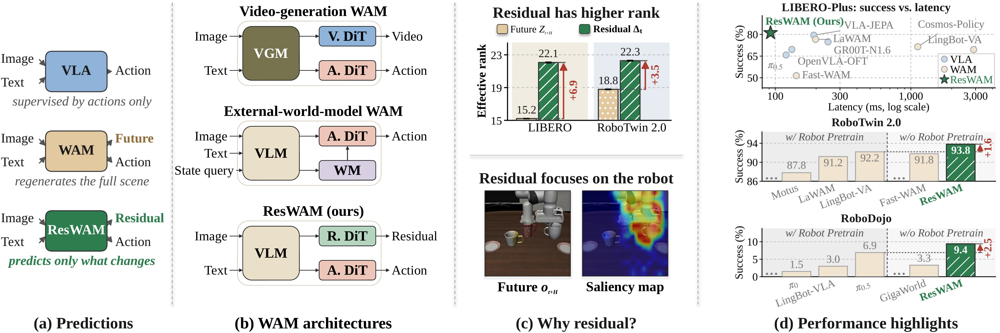

<div align="center">

# ResWAM: Learning What Changes, Not What Stays, for World-Action Models

<p align="center">
  <a href="https://arxiv.org/abs/2611.19559"></a>
  <a href="https://chongyu-fan.netlify.app/posts/reswam/"></a>
  <a href="https://github.com/OPTML-Group/ResWAM"></a>
  <a href="https://huggingface.co/collections/OPTML-Group/reswam-6af8906dc9b6f21539b30934"></a>
  <a href="LICENSE"></a>
  <a href="https://pytorch.org/"></a>
</p>

</div>

<p align="center">
  <b>Chongyu Fan</b><sup>†</sup> &emsp;
  <b>Gaowen Liu</b><sup>‡</sup> &emsp;
  <b>Ramana Rao Kompella</b><sup>‡</sup> &emsp;
  <b>Jason Corso</b><sup>¶</sup> &emsp;
  <b>Sijia Liu</b><sup>†,§</sup>
</p>

<p align="center">
  <sup>†</sup>Michigan State University &emsp;
  <sup>‡</sup>Cisco &emsp;
  <sup>¶</sup>University of Michigan &emsp;
  <sup>§</sup>IBM Research
</p>

<hr />

This is the official code repository for the paper [**"ResWAM: Learning What Changes, Not What Stays, for World-Action Models"**](https://arxiv.org/abs/2611.19559), which introduces **ResWAM** (Residual World-Action Model), a residual world-action model with 2.3B parameters in total, including a lightweight 0.5B dual-branch DiT that learns visual token residuals in a frozen DINOv3 space alongside action chunks via conditional flow matching. See the [project page](https://chongyu-fan.netlify.app/posts/reswam/) and the [Hugging Face Collection](https://huggingface.co/collections/OPTML-Group/reswam-6af8906dc9b6f21539b30934) for more.

<p align="center">
  
</p>

<p align="center">
  <em>Schematic overview of <b>ResWAM</b> across <b>(a)</b> predictions, <b>(b)</b> architectures, <b>(c)</b> benefits of residuals, and <b>(d)</b> performance highlights.
  <b>(a)</b> Predictions of VLAs, WAMs, and ResWAM.
  <b>(b)</b> Architectures of WAMs: video-generation WAMs use a video generation model (VGM); external-world-model WAMs use a vision-language model (VLM) and separate world model (WM); ResWAM is built on a VLM with residual and action branches. V. DiT, A. DiT, and R. DiT denote video, action, and residual Diffusion Transformers, respectively.
  <b>(c)</b> Residual features have higher effective rank and focus on the robot and manipulated objects.
  <b>(d)</b> LIBERO-Plus success versus latency, and RoboTwin 2.0 and RoboDojo average success rates across methods. Here w/ and w/o Robot Pretrain indicate with and without robot pretraining on external robot action datasets prior to downstream training.</em>
</p>

## Abstract

World-action models (WAMs) augment vision-language-action policies (VLAs) with future prediction so that the policy can anticipate how its actions will affect the physical world. Existing WAMs supervise complete future observations. However, observations typically change little over an action chunk, so the future loss is dominated by copying static background content rather than learning task-relevant robot and object motion, limiting policy learning. Moreover, existing WAMs rely on large video generation models or separate world models, incurring heavy training and inference compute that hinders closed-loop deployment. To improve policy performance, we propose *visual residual learning*, supervising only the feature change from the current frame to the future frame in a frozen DINOv3 space. Compared with complete future features, this residual learning target yields a higher feature rank with richer and more diverse representations of scene changes, and spatially concentrates on the robot arm and manipulated objects rather than the background. To further improve computational efficiency, we present **ResWAM**, a residual world-action model with 2.3B parameters in total, including a lightweight 0.5B dual-branch DiT that jointly trains an action branch and a residual branch via conditional flow matching. Without robot pretraining (*i.e.*, pretraining on external robot action trajectories beyond the benchmark demonstrations), **ResWAM** achieves top average success rates on LIBERO-Plus (81.1%), RoboTwin 2.0 (93.8%), and RoboDojo (9.40% success, 13.41 score) at the lowest training (2.7–4.0 TFLOPs) and inference compute (1.0–1.4 TFLOPs), and leads real-robot Open, Put, and Stack (80.0% average, +10.0% over π<sub>0.5</sub>) at 92.7 ms latency.

## What's in this repo

```
ResWAM/
├── configs/
│   ├── libero_plus.yaml             # LIBERO training and LIBERO-Plus evaluation
│   ├── robotwin2.yaml               # RoboTwin 2.0 training and evaluation
│   ├── robodojo.yaml                # RoboDojo stage 1 (cosine to 200k) and evaluation
│   └── robodojo_stage2.yaml         # RoboDojo stage 2 (200k -> 400k, constant LR)
├── reswam/
│   ├── models/                      # RynnBrain-1.1-2B VLM, frozen DINOv3-B/16, Dual-Stream DiT, flow objective
│   ├── data/                        # Window dataset, normalization codecs, trajectory cleaning, augmentation, DINOv3 cache
│   ├── engine/                      # Distributed FSDP trainer, cosine scheduler, atomic checkpointing
│   └── utils/                       # Config loader, distributed helpers, Websocket policy server, B-spline smoothing
├── scripts/
│   ├── env/                         # Environment setup scripts
│   ├── data_prep/                   # Dataset preparation and optional DINOv3 cache extraction
│   ├── train/                       # Multi-GPU torchrun FSDP training launchers
│   └── eval/                        # Benchmark evaluation scripts
└── tests/
    └── test_smoke.py                # Unit and smoke tests
```

## Model Checkpoints

Official checkpoints and normalization statistics are hosted in our [Hugging Face Collection](https://huggingface.co/collections/OPTML-Group/reswam-6af8906dc9b6f21539b30934):

| Benchmark | Model Repository | Checkpoint | Metric | Latency |
| :- | :- | :- | :- | :- |
| **LIBERO / LIBERO-Plus** | [`OPTML-Group/ResWAM-LIBERO`](https://huggingface.co/OPTML-Group/ResWAM-LIBERO) | `model.pt` | **81.1%** Avg. SR (10,030 episodes) | **92.2 ms** |
| **RoboTwin 2.0** | [`OPTML-Group/ResWAM-RoboTwin2`](https://huggingface.co/OPTML-Group/ResWAM-RoboTwin2) | `model.pt` | **93.8%** Avg. SR (93.6% Clean / 94.0% Random) | **99.4 ms** |
| **RoboDojo** | [`OPTML-Group/ResWAM-RoboDojo`](https://huggingface.co/OPTML-Group/ResWAM-RoboDojo) | `model.pt` | **9.40%** SR / **13.41** Score | **99.7 ms** |

The released weights are the exact checkpoints behind the paper numbers (RoboTwin 2.0 is evaluated with p32e16). Each repository also contains `codec_statistics.json` (action/state normalization); the evaluation scripts pick it up automatically when it sits next to `model.pt`.

Download any checkpoint repository with `huggingface_hub`:

```bash
hf download OPTML-Group/ResWAM-LIBERO --local-dir ./checkpoints/ResWAM-LIBERO
hf download OPTML-Group/ResWAM-RoboTwin2 --local-dir ./checkpoints/ResWAM-RoboTwin2
hf download OPTML-Group/ResWAM-RoboDojo --local-dir ./checkpoints/ResWAM-RoboDojo
```

## Getting Started

### Core Environment

```bash
git clone https://github.com/OPTML-Group/ResWAM.git
cd ResWAM
bash scripts/env/setup_reswam.sh --download-weights
```

This creates a Python 3.10 environment with PyTorch 2.6.0 (CUDA 12.4) and transformers 5.2.0, the versions used for all paper runs, and downloads RynnBrain-1.1-2B and DINOv3-B/16 at their pinned revisions. For training, add `--train-kernels` to also install the Gated-DeltaNet kernels used by the official runs (`flash-linear-attention` 0.4.2 and `causal-conv1d`, see `requirements-train.txt`). Evaluation does not need them.

### Simulator Environments

```bash
bash scripts/env/setup_libero_plus.sh
bash scripts/env/setup_robotwin2.sh
bash scripts/env/setup_robodojo.sh
```

| Benchmark | Simulator stack (pinned to the official evaluation) |
| :- | :- |
| LIBERO-Plus | LIBERO-plus `4976dc3`, Python 3.11, MuJoCo 3.3.2, robosuite 1.4.1, assets `sha256 96764a4b…`. Requires ImageMagick (`libmagickwand`) for the sensor-noise perturbations. |
| RoboTwin 2.0 | RoboTwin `bf44be5`, Python 3.10, SAPIEN 3.0.0b1, mplib 0.2.1, CuRobo `cca894d`. RoboTwin's optional mplib/SAPIEN source patches are not applied, matching the official run. Download the assets with `script/_download_assets.sh`. |
| RoboDojo | RoboDojo `726e9aa` (XPolicyLab `bb9a0b5`, IsaacLab `afca7b0`, CuRobo `d17b54c`). The simulator runs in RoboDojo's own conda env (`scripts/install.sh -i`: Python 3.11, Isaac Sim 5.1.0, Isaac Lab 2.3, PyTorch 2.7/cu128), and the ResWAM policy server runs in the ResWAM environment. Isaac Sim 5.1 needs Ubuntu 22.04, an RTX GPU with RT cores (A100/H100 are not supported), driver 570/580, and Vulkan. |

## Data Preparation

Prepare dataset contracts and normalization statistics before training:

```bash
# LIBERO
python scripts/data_prep/prepare_libero.py \
    --dataset-root ./data/libero \
    --output-dir ./data/prepared/libero

# RoboTwin 2.0
python scripts/data_prep/prepare_robotwin2.py \
    --dataset-root ./data/robotwin2 \
    --output-dir ./data/prepared/robotwin2

# RoboDojo
python scripts/data_prep/prepare_robodojo.py \
    --dataset-root ./data/robodojo \
    --output-dir ./data/prepared/robodojo
```

Frozen DINOv3 features are computed online by default. To optionally pre-extract DINOv3 feature caches for higher training throughput:

```bash
python scripts/data_prep/extract_dinov3_cache.py \
    --dataset-config ./data/prepared/robotwin2/reswam.json \
    --out-root ./cache/dino/robotwin2 \
    --gpus 0,1,2,3
```

## Training

### LIBERO

```bash
NPROC_PER_NODE=2 bash scripts/train/train_libero.sh
```

### RoboTwin 2.0

```bash
NPROC_PER_NODE=4 bash scripts/train/train_robotwin2.sh
```

### RoboDojo

RoboDojo trains in two stages. Stage 1 runs warmup plus cosine decay to 200k steps. Stage 2 resumes from the stage-1 step-200k state and trains to 400k steps at the constant floor learning rate (VLM 1e-6, expert 1e-5).

```bash
NPROC_PER_NODE=4 bash scripts/train/train_robodojo.sh                  # stage 1: 0 -> 200k
NPROC_PER_NODE=4 RESWAM_STAGE=2 bash scripts/train/train_robodojo.sh   # stage 2: 200k -> 400k
```

Pass `--use-dino-cache` to any launcher to train from pre-extracted DINOv3 caches, or `--pi05-aug` to enable shared temporal image augmentation (off for all released checkpoints).

## Evaluation

### LIBERO-Plus

```bash
python scripts/eval/eval_libero_plus.py run \
    --checkpoint ./checkpoints/ResWAM-LIBERO/model.pt \
    --libero-plus-root ./third_party/LIBERO-plus \
    --output-dir ./outputs/libero/eval_libero_plus \
    --gpus 0,1,2,3
```

### RoboTwin 2.0

```bash
python scripts/eval/eval_robotwin2.py run \
    --checkpoint ./checkpoints/ResWAM-RoboTwin2/model.pt \
    --robotwin-root ./third_party/RoboTwin \
    --output-dir ./outputs/robotwin2/eval_p32e16 \
    --gpus 0,1,2,3
```

### RoboDojo

```bash
python scripts/eval/eval_robodojo.py run \
    --checkpoint ./checkpoints/ResWAM-RoboDojo/model.pt \
    --robodojo-root ./third_party/RoboDojo \
    --policy-env ./envs/reswam \
    --sim-env RoboDojo \
    --output-dir ./outputs/robodojo/eval_p32e10 \
    --gpus 0,1,2,3
```

Run the LIBERO-Plus and RoboTwin 2.0 evaluators from the environments created by `setup_libero_plus.sh` and `setup_robotwin2.sh`. Run the RoboDojo evaluator from the ResWAM environment; it launches the Isaac Sim client in the `RoboDojo` conda env.

## Citation

If you find this work useful, please consider citing:

```bibtex
@article{fan2026reswam,
  title={ResWAM: Learning What Changes, Not What Stays, for World-Action Models},
  author={Fan, Chongyu and Liu, Gaowen and Kompella, Ramana Rao and Corso, Jason and Liu, Sijia},
  journal={arXiv preprint arXiv:2611.19559},
  year={2026}
}
```

## Acknowledgements

This codebase builds on [RynnBrain](https://github.com/Alibaba-DAMO-Academy/RynnBrain), [DINOv3](https://github.com/facebookresearch/dinov3), [LeRobot](https://github.com/huggingface/lerobot), [LIBERO-Plus](https://github.com/sylvestf/LIBERO-plus), [RoboTwin 2.0](https://github.com/RoboTwin-Platform/RoboTwin), and [RoboDojo](https://github.com/RoboDojo-Benchmark/RoboDojo).
